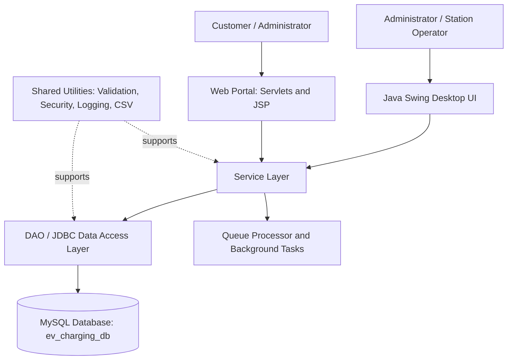

# Smart EV Charging Network Planning and Management System

**Case Study:** ABC Green Energy Solutions Pvt. Ltd.  
**Project Type:** Java-based EV charging network management system  
**Build Tool:** Maven

## Project Overview

The Smart EV Charging Network Planning and Management System supports the day-to-day operation of an electric-vehicle charging network. It brings station and charger management, customer and vehicle records, bookings, charging sessions, queue handling, billing, reporting, and monitoring into one application backed by a shared MySQL database.

The system provides two user-facing interfaces: a Java Swing desktop application for administrators and station operators, and a web portal for customers and administrators. Both interfaces use shared service and data-access layers to keep business rules and records consistent.

## Project Objectives

- **Centralize network operations:** Manage users, customers, vehicles, stations, chargers, bookings, and charging sessions in one system.
- **Improve charger utilization:** Track charger availability and status, and support queue-based allocation when chargers are busy.
- **Simplify customer journeys:** Support bookings, charging activity, session history, bills, and payment workflows through the web portal.
- **Automate operational tasks:** Use background processing for queue management and simulated charging-network activity.
- **Support monitoring and decisions:** Provide dashboards, demand summaries, utilization reports, notifications, and CSV exports.
- **Maintain reliable records:** Use a relational database, validation, transaction handling, and application logging.
- **Demonstrate software-engineering concepts:** Apply object-oriented design, layered architecture, JDBC, exception handling, collections, multithreading, GUI development, web technologies, and automated tests.
- **Enable future expansion:** Provide extension points for demand forecasting, optimization, and GIS-based capabilities.

## Key Features and Modules

### Administration and Operations

- Role-based access for administrators, station operators, and customers.
- Operational dashboard with key performance indicators, charger status, demand trends, and notifications.
- Station and charger management, including fault reporting and status tracking.
- Customer, vehicle, booking, and charging-session management.
- Queue monitoring and allocation when a charger becomes available.
- Billing, invoices, payment workflow, and audit/application logs.
- Reports with CSV export and database backup support.

### Customer Web Portal

- Customer login and dashboard.
- Browse charging stations and available charging options.
- Book charging slots or initiate a charging workflow.
- View charging history and bills, use the payment workflow, and download invoices.

### Core Services and Reliability

- JDBC-based data access using prepared statements and transaction support.
- Password hashing and input validation.
- Background queue processing and producer-consumer simulation.
- Application logging, custom exceptions, and shared utility components.
- JUnit tests for core logic and selected integration workflows.

## System Architecture

The project follows a layered architecture. The desktop and web interfaces call the shared service layer. Services enforce business rules and coordinate workflows, while Data Access Objects (DAOs) use JDBC to persist and retrieve data from MySQL. Shared utilities support database connectivity, validation, password handling, logging, CSV operations, and other infrastructure concerns.



### Architecture Layers

| Layer | Responsibilities | Main Components / Examples |
|---|---|---|
| Presentation | Provides user interaction and displays application data | Java Swing frames and panels, Servlets, JSP, HTML, CSS, JavaScript |
| Service | Implements business rules and coordinates workflows | Booking, charging sessions, billing, reporting, queue processing |
| Data Access | Executes database queries and manages persistence | DAO classes, JDBC, prepared statements, transaction handling |
| Model | Represents the system's core domain entities | Users, customers, vehicles, stations, chargers, bookings, sessions, payments |
| Utilities and Exceptions | Provides shared infrastructure and consistent error handling | Database connection utilities, validation, password utilities, CSV, logging, custom exceptions |
| Database | Stores persistent relational data | MySQL tables, relationships, constraints, reporting view, operational records |
| Background Processing | Handles asynchronous operational work | Queue processor and producer-consumer simulation |

The web portal runs on embedded Apache Tomcat. The desktop application and web portal can operate independently while sharing the same service/data-access design and MySQL database.

## Technology Stack

| Technology | Role in the Project |
|---|---|
| **Java 17+** | Main programming language; supports object-oriented domain modelling, application services, exception handling, collections, and concurrency. |
| **Java Swing** | Desktop graphical interface for administrative and station-operator workflows. |
| **Java Servlets** | Handles web requests and coordinates request/response processing in the web portal. |
| **JavaServer Pages (JSP)** | Renders server-side web pages and application views. |
| **Embedded Apache Tomcat 10.1** | Hosts the web application and provides the servlet container. |
| **MySQL 8** | Relational database for users, vehicles, stations, chargers, bookings, charging sessions, billing, and related records. |
| **JDBC** | Connects Java application components to MySQL and executes SQL operations. |
| **MySQL Connector/J 8.4.0** | JDBC driver used for MySQL connectivity. |
| **Maven** | Manages project dependencies, build configuration, and project structure. |
| **FlatLaf 3.5.1** | Provides a modern look and feel for the Swing desktop interface. |
| **HTML** | Structures pages in the customer and administration web portal. |
| **CSS** | Defines web page styling, layout, and presentation. |
| **JavaScript** | Supports client-side interactions and dynamic web interface behaviour. |
| **Chart.js** | Displays dashboard charts and visual summaries. |
| **JUnit 5** | Supports unit testing and selected integration tests. |
| **Git and GitHub** | Support version control, change tracking, and collaboration. |
| **CSV and Java File I/O** | Support report exports, file operations, logs, and backup-related workflows. |

## Data and Domain Model

The MySQL database, `ev_charging_db`, stores the system's operational records. The domain includes:

- **Identity and access:** Users, roles, and customer/operator access.
- **Vehicles:** Customer vehicle records used in charging workflows.
- **Charging infrastructure:** Stations, chargers, charger availability, and maintenance/fault records.
- **Bookings and sessions:** Reservations, charging-session lifecycle, and session history.
- **Queue management:** Queue entries and allocation/processing history.
- **Billing and payments:** Bills, invoices, and payment workflow records.
- **Demand and reporting:** Hourly demand records, reporting views, operational summaries, and exports.

The project includes SQL schema and demo-data scripts as part of its database assets. They are documented here as project artefacts; they do not need to be rerun merely because application source code changes.

## Project Structure

```text
EVChargingSystem/
├── pom.xml                         # Maven configuration and dependencies
├── database/
│   ├── 01_schema.sql               # Database schema, relationships, and constraints
│   └── 02_seed_data.sql            # Demonstration records
├── eclipse-launch/                 # Eclipse launch configurations
├── docs/                           # Requirements, design, database, test and project documentation
├── src/
│   ├── main/
│   │   ├── java/com/abcgreen/evcharging/
│   │   │   ├── model/              # Domain entities
│   │   │   ├── dao/                # JDBC data-access objects
│   │   │   ├── service/            # Business logic and queue processing
│   │   │   ├── exception/          # Custom exceptions
│   │   │   ├── util/               # Database, validation, security, logging and CSV utilities
│   │   │   ├── ui/                 # Swing desktop application
│   │   │   ├── web/                # Embedded Tomcat, filters and servlets
│   │   │   ├── tools/              # Database-related utility tools
│   │   │   └── future/             # Extension points for future capabilities
│   │   └── webapp/                 # JSP, web.xml, CSS, JavaScript and web assets
│   └── test/java/                  # JUnit tests
├── reports/                        # Generated reports and exports
├── backups/                        # Database backup output
└── logs/                            # Application logs
```

## Testing and Quality Practices

The project uses JUnit 5 for tests covering core validation and business logic, password utilities, billing, charger calculations, CSV handling, queue simulation, and selected database-backed workflows. Integration tests may depend on database availability. Prepared statements, transaction handling, input validation, password hashing, custom exceptions, and application logging are used to support reliability and maintainability.

## Future Scope

Potential enhancements include:

- Machine-learning-based charging-demand forecasting.
- Optimization of charging-station placement and charger allocation.
- Route-aware charging recommendations for EV drivers.
- GIS-based maps and location-aware station discovery.
- Deeper integration with real charging hardware, payment providers, and external mobility services.

These items represent possible future extensions and should not be considered implemented unless separately developed and validated.

---

**Project Note:** This is an academic/demo system. Production deployment would require further review of authentication and authorization, payment integration, secret management, operational monitoring, and infrastructure security.
