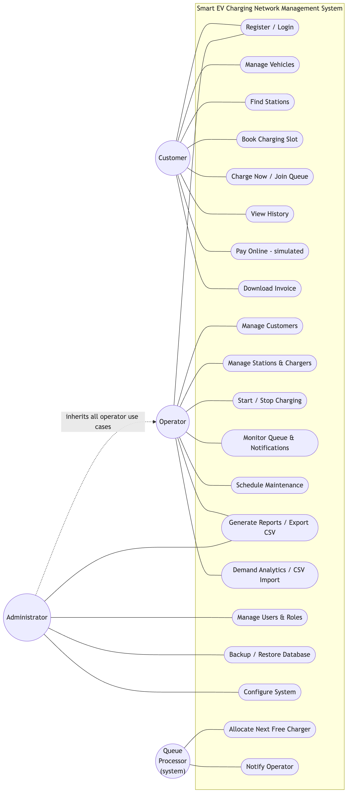
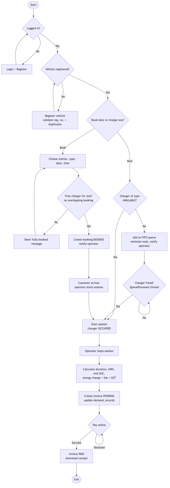
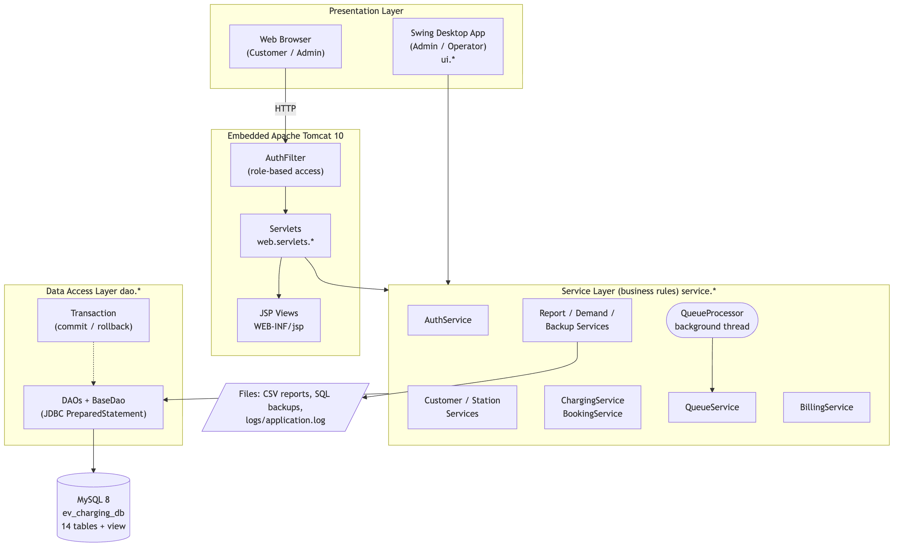
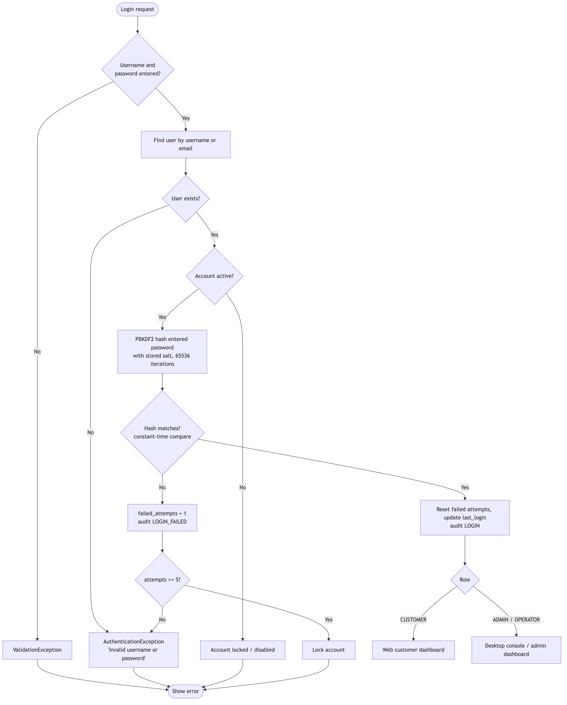
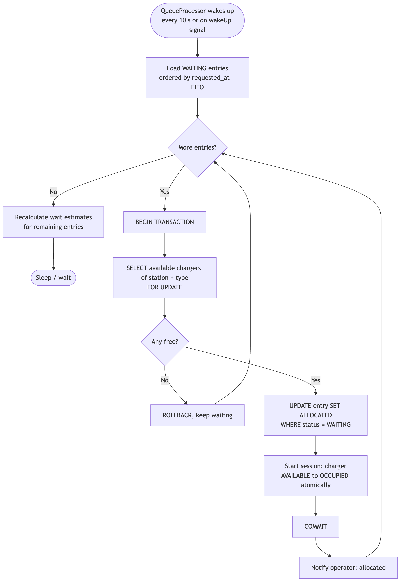
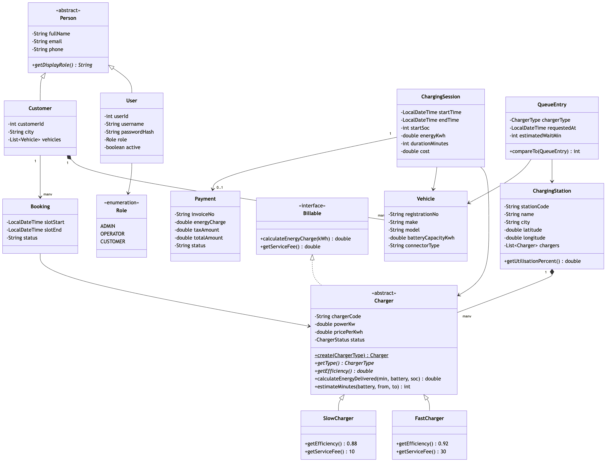
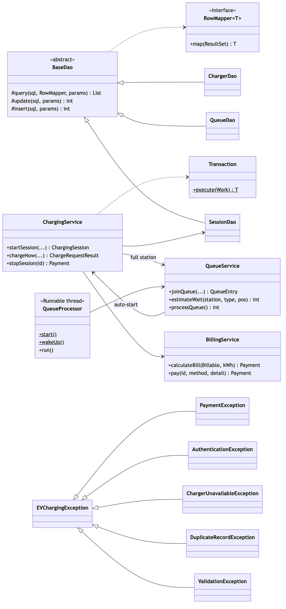
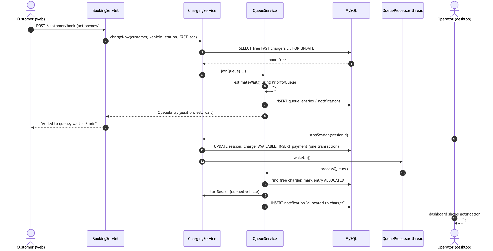
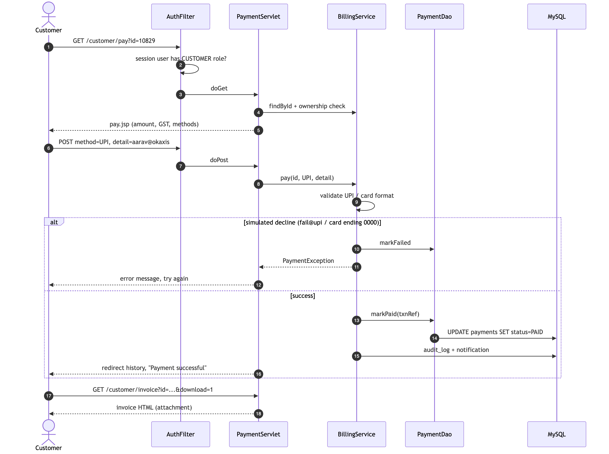

# System Analysis, Design and UML (Weeks 3, 4 and 5)

All diagrams are in `docs/diagrams/`. Each one has a `.mmd` source file (Mermaid, which can be edited at https://mermaid.live) and a rendered `.png`.

---

## 1. System analysis (Week 3)

### 1.1 Actors
| Actor | Type | Description |
|---|---|---|
| Customer | Primary | EV owner using the web portal |
| Operator | Primary | Station staff using the desktop console |
| Administrator | Primary | Operator rights, plus users, backup and configuration |
| Queue Processor | System | Background thread that allocates chargers and sends notifications |

### 1.2 Use case diagram


### 1.3 Main use cases

| UC | Name | Actor | Main flow | Alternate flows |
|---|---|---|---|---|
| UC1 | Register / Login | Customer, staff | Enter credentials → hash verified → dashboard by role | Wrong password (attempts left); locked after 5; duplicate email or phone on registration |
| UC4 | Book charging slot | Customer, operator | Choose vehicle, station, type, date/time → system picks a free charger → BOOKED + notification | Slot in the past; all chargers booked → "fully booked" message |
| UC5 | Charge now / join queue | Customer, operator | Free charger → session starts | All busy → queued with position and estimated wait; operator notified |
| UC11 | Start / stop charging | Operator | Stop → duration, kWh, SOC, bill → receipt | Session already stopped; charger busy |
| UC7 | Pay online | Customer | Choose method → simulated gateway → PAID + transaction ref | Declined → FAILED, retry |
| UC19 | Allocate next free charger | Queue Processor | Charger freed → first waiting entry allocated → session auto-started → notification | No free charger → estimate updated |
| UC14 | Generate reports | Operator, admin | Choose report → table → export CSV | – |
| UC17 | Backup / restore | Administrator | Backup to `backups/*.sql`; restore in one transaction | Bad file → rollback, data unchanged |

### 1.4 Business process / workflow


---

## 2. System design (Week 4)

### 2.1 Architecture: layered (n-tier)


| Layer | Package | Responsibility |
|---|---|---|
| Presentation (desktop) | `ui`, `ui.panels`, `ui.components` | Swing screens, event handling, charts |
| Presentation (web) | `web`, `web.servlets`, `src/main/webapp` | Embedded Tomcat, AuthFilter, servlets (controllers), JSP (views) |
| Service | `service` | Business rules, validation, transactions, queue thread, billing, reports |
| Data access | `dao` | JDBC CRUD, SQL, row mapping, transactions |
| Domain model | `model` | Entities and enums (OOP hierarchy) |
| Cross-cutting | `util`, `exception` | DB connection, hashing, validation, CSV, logging, custom exceptions |
| Tools | `tools` | Database setup and seed data generator |

**Design patterns used:** Layered architecture, DAO, MVC on the web (Servlet = controller, JSP = view, model objects), Factory Method (`Charger.create`), Template Method (`CrudPanel`, `ChartPanel`) and Observer (QueueProcessor listeners refresh the UI), and Front-filter (`AuthFilter`).

### 2.2 Package structure
```
com.abcgreen.evcharging
├── model        Person, User, Customer, Vehicle, ChargingStation, Charger, FastCharger, SlowCharger,
│                Billable, Booking, ChargingSession, QueueEntry, Payment, MaintenanceRecord,
│                Notification, ReportData, DashboardStats, Role, ChargerType, ChargerStatus
├── exception    EVChargingException, ValidationException, DuplicateRecordException,
│                AuthenticationException, RecordNotFoundException, ChargerUnavailableException,
│                PaymentException, DataAccessException
├── util         DBConnection, PasswordUtil, Validator, CsvUtil, AppLogger, SqlScriptRunner
├── dao          BaseDao, RowMapper, Transaction, UserDao, CustomerDao, VehicleDao, StationDao,
│                ChargerDao, BookingDao, SessionDao, QueueDao, PaymentDao, MaintenanceDao,
│                NotificationDao, AuditDao, ConfigDao, ReportDao
├── service      AuthService, CustomerService, StationService, BookingService, ChargingService,
│                QueueService, QueueProcessor, QueueSimulator, BillingService, InvoiceGenerator,
│                ReportService, DemandService, BackupService, NotificationService, AuditService,
│                ConfigService, SecurityContext, ChargeRequestResult
├── ui           DesktopApp, LoginFrame, MainFrame, UiKit, Refreshable
│   ├── components  BeanTable, FormDialog, StatCard, ChartPanel, BarChart, LineChart, DonutChart, ReportView
│   └── panels      Dashboard, Customers, Vehicles, Stations, Charging, Queue, Billing,
│                   Maintenance, Demand, Reports, Users, System, CrudPanel, ReceiptDialog
├── web          WebApp, AuthFilter
│   └── servlets    Home, Login, Register, Logout, CustomerDashboard, Vehicle, Booking, History,
│                   Payment, Invoice, AdminDashboard, AdminReport, StationApi
└── tools        DatabaseSetup, SeedDataGenerator
```

### 2.3 Key algorithms

**A. Login with lockout**


**B. Energy, duration and bill calculation** (`ChargingService.stopSession`, `Charger`, `BillingService`)
```
simulatedMinutes = realElapsedSeconds / 60 × simulation_speed_factor
minutesToFull   = ceil( battery × (100 − startSOC)/100 ÷ (power × efficiency) × 60 )
minutes         = min(simulatedMinutes, minutesToFull)            // a full battery stops charging
energy (kWh)    = min( power × efficiency × minutes/60 , battery × (100 − startSOC)/100 )
endSOC          = startSOC + energy ÷ battery × 100
energyCharge    = energy × tariff (Rs/kWh)
serviceFee      = 30 (FAST) or 10 (SLOW)                          // polymorphic
GST             = (energyCharge + serviceFee) × 18%
total           = energyCharge + serviceFee + GST
```
Fast chargers use 92% efficiency and slow chargers 88%. Two-wheelers (battery under 10 kWh) draw at most 3.3 kW on a fast charger.

**C. Waiting-time estimate** (`QueueService.estimateWait`, using a `PriorityQueue`)
```
avg = average completed session length at this station and charger type
freeAt = PriorityQueue of (avg − elapsed) for every active session, plus 0 for every free charger
repeat position times:  t = freeAt.poll();  freeAt.add(t + avg)
estimated wait = t (the last value taken)
```

**D. Automatic queue allocation** (`QueueProcessor` thread and `QueueService.processQueue`)


The worker thread waits on a monitor object (`wait(timeout)`). `stopSession`, charger repair and maintenance completion call `QueueProcessor.wakeUp()` (`notifyAll`), so allocation happens immediately rather than at the next poll.

**E. Booking without double booking** (`BookingService.book`)
1. Filter the station's chargers by type, excluding faulty and maintenance ones (stream + lambda). Sort by power, highest first.
2. For each charger, check for overlap: `slot_start < requestedEnd AND slot_end > requestedStart` among BOOKED or IN_PROGRESS bookings.
3. The first charger with no overlap gets the booking. If there is none, throw `ChargerUnavailableException`.

---

## 3. UML design (Week 5)

### 3.1 Class diagram: domain model


### 3.2 Class diagram: services, DAO and exceptions


### 3.3 Sequence diagram: charge now → queue → automatic allocation


### 3.4 Sequence diagram: online payment and invoice


### 3.5 Activity diagrams
- Charging workflow: `diagrams/07_activity_charging.png`
- Login: `diagrams/08_activity_login.png`
- Queue allocation: `diagrams/10_queue_algorithm.png`

### 3.6 Object relationships
| Relationship | Example |
|---|---|
| Inheritance | `User`, `Customer` extend abstract `Person`; `FastCharger`, `SlowCharger` extend abstract `Charger`; all custom exceptions extend `EVChargingException`; panels extend `CrudPanel<T>` |
| Interface implementation | `Charger implements Billable`; `QueueProcessor implements Runnable`; `QueueEntry implements Comparable` |
| Composition | `ChargingStation` has a `List<Charger>`; `Customer` has a `List<Vehicle>` |
| Association | `ChargingSession` → `Charger`, `Vehicle`; `Booking` → `Charger`; `Payment` → `ChargingSession` |
| Dependency | Services use DAOs; servlets and panels use services |

---

## 4. Mapping of Java course modules to the code

| Module | Concept | Class / location |
|---|---|---|
| I | Strings and regular expressions | `Validator` (email, phone, vehicle number) |
| I | Loops and conditions | `PasswordUtil.isStrong`, `ReportDao.peakHourDemand` |
| I | Arrays | `int[24]` hourly demand, `String[]` report columns, `Vehicle.TYPES` |
| I | Operators | Billing and energy formulas |
| II | Classes, objects, constructors | All `model` classes |
| II | Inheritance and abstraction | `Person`, `Charger`, `ChartPanel`, `CrudPanel` |
| II | Interfaces | `Billable`, `RowMapper`, `Refreshable` |
| II | Polymorphism | `charger.getEfficiency()` / `getServiceFee()`; `ChartPanel.drawChart` |
| II | Encapsulation and packages | Private fields with getters/setters; 10 packages |
| III | Custom exceptions | `exception` package, shown in dialogs and on web pages |
| III | Multithreading | `QueueProcessor` (wait/notify), `QueueSimulator` (producer/consumer), `SwingWorker` |
| III | File handling | `CsvUtil`, `DemandService.importCsv`, `BackupService`, `ReceiptDialog`, `AppLogger` |
| IV | ArrayList / HashMap | DAO result lists, `ChargerDao.countByStatus`, `QueueService.waiting` |
| IV | Queue / Stack / PriorityQueue | `QueueSimulator` (`LinkedList` as `Queue`), `StationsPanel` undo `Stack`, `QueueService.estimateWait` |
| IV | Lambdas and streams | `RowMapper` lambdas, `BeanTable` row mappers, `BookingService` filtering |
| IV | Swing GUI and events | `ui` package (JFrame, JTable, JTabbedPane, dialogs, listeners, Timer) |
| V | JDBC CRUD and transactions | `BaseDao`, `Transaction`, all DAOs |
| V | Servlets and HTTP | `web.servlets`, `AuthFilter`, GET/POST, redirects, sessions, file download |
| V | JSP | `WEB-INF/jsp/*` (scriptlets, includes, Chart.js dashboard) |
