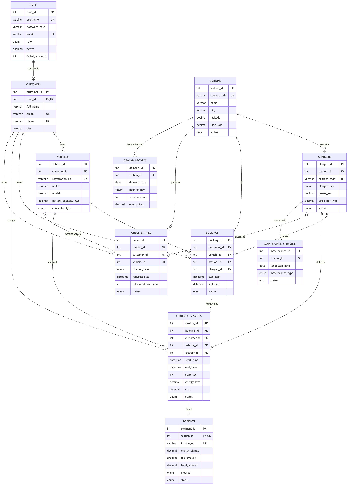

# Database Design (Week 6)

**DBMS:** MySQL 8 (InnoDB, utf8mb4) · **Database:** `ev_charging_db`
**Scripts:** `database/01_schema.sql` (DDL) and `database/02_seed_data.sql` (demo data)

## 1. ER diagram


## 2. Tables

| # | Table | Purpose | Primary key | Foreign keys | Unique / check constraints |
|---|---|---|---|---|---|
| 1 | `users` | Login accounts (ADMIN / OPERATOR / CUSTOMER) | user_id | – | username, email |
| 2 | `customers` | EV owners | customer_id | user_id → users (SET NULL) | email, phone, user_id |
| 3 | `vehicles` | Customer EVs | vehicle_id | customer_id → customers (CASCADE) | registration_no; battery > 0 |
| 4 | `stations` | Charging stations | station_id | – | station_code |
| 5 | `chargers` | Fast / slow chargers | charger_id | station_id → stations (CASCADE) | charger_code; power > 0; price > 0 |
| 6 | `bookings` | Slot reservations | booking_id | customer, vehicle, station, charger | slot_end > slot_start |
| 7 | `charging_sessions` | Charging events | session_id | booking (SET NULL), customer, vehicle, charger | start_soc 0–100 |
| 8 | `queue_entries` | Waiting queue | queue_id | station, customer, vehicle, allocated_charger | – |
| 9 | `payments` | Bills / invoices / simulated payments | payment_id | session_id → charging_sessions | session_id (one bill per session), invoice_no |
| 10 | `maintenance_schedule` | Charger maintenance | maintenance_id | charger_id → chargers | – |
| 11 | `demand_records` | Hourly historical demand per station | demand_id | station_id → stations | (station_id, demand_date, hour_of_day); hour 0–23 |
| 12 | `notifications` | In-app operator notifications | notification_id | – | – |
| 13 | `audit_log` | Transaction / activity log | log_id | – | – |
| 14 | `system_config` | Configurable settings | config_key | – | – |
| View | `v_station_capacity` | Live capacity: total / fast / slow / available / occupied / faulty / maintenance / kW per station | | | |

Statuses use `ENUM` columns, for example charger status `AVAILABLE, OCCUPIED, FAULTY, MAINTENANCE`, so invalid values are rejected by the database.

**Indexes:** `bookings(charger_id, slot_start, slot_end)` for overlap checks, `charging_sessions(start_time)` and `(status)` for reports and active sessions, `queue_entries(status, requested_at)` for FIFO order, `notifications(is_read, created_at)` and `audit_log(created_at)`.

## 3. Normalisation

**1NF.** All columns are atomic (no lists inside a column). Every table has a primary key. A customer's vehicles are rows in `vehicles`, not a comma-separated column. A station's chargers are rows in `chargers`.

**2NF.** Every table has a single-column surrogate key, so there are no partial dependencies. The composite natural key of `demand_records` (station, date, hour) is enforced with a UNIQUE constraint, and its measures depend on the whole key.

**3NF.** There are no transitive dependencies:
- The station name and city are stored only in `stations`. Chargers, bookings and sessions reference `station_id` (sessions reach the station through `charger_id`).
- The tariff is stored on the charger. The session stores the calculated `cost` at the time of charging (a historical fact, so later tariff changes do not alter old bills).
- Customer login data (password hash, role) lives in `users`. Profile data lives in `customers`, linked 1:1.
- Payment amounts depend only on the payment (session) they belong to.

**Controlled redundancy:** `demand_records` is an aggregate of `charging_sessions`. It is kept on purpose as the analytical data set for the future forecasting module, and so that external demand data can be imported from CSV. It is updated in the same transaction that completes a session.

## 4. Referential integrity rules
- Deleting a **station** deletes its chargers, and through them their sessions, bookings and maintenance (CASCADE).
- Deleting a **customer** deletes their vehicles, bookings, sessions and queue entries.
- Deleting a **user account** keeps the customer profile (`ON DELETE SET NULL`).
- Deleting a **booking** keeps the session (`SET NULL`), because sessions are financial history.

## 5. Transactions used by the application
| Operation | Statements in one transaction |
|---|---|
| Customer registration | INSERT users + INSERT customers |
| Start session | UPDATE chargers (AVAILABLE→OCCUPIED, only if still available) + INSERT session + UPDATE booking |
| Stop session | UPDATE session + UPDATE charger + UPDATE booking + UPSERT demand_records + INSERT payment |
| Queue allocation | SELECT … FOR UPDATE chargers + UPDATE queue entry + start-session statements |
| Maintenance start / complete | UPDATE maintenance + UPDATE charger status |
| Restore | DELETE all tables + INSERT all rows (rollback on any error) |

## 6. Demo data volume (`02_seed_data.sql`)
| Table | Rows |
|---|---|
| users | 604 |
| customers | 600 |
| vehicles | 712 |
| stations | 24 (8 cities) |
| chargers | 138 |
| charging_sessions | ~10,800 (last 90 days, realistic peak hours, growth trend, weekend effect) |
| payments | ~10,800 |
| bookings | ~3,000 |
| demand_records | ~9,300 |
| queue_entries | ~490 |
| maintenance_schedule | ~250 |
| audit_log | 400 |

All timestamps are written as expressions relative to `CURDATE()` / `NOW()`, so the data is always "fresh" whenever the script is executed. The seed file is generated by `tools/SeedDataGenerator.java` (fixed random seed, so it is reproducible).

## 7. Useful SQL queries for the viva
```sql
-- live capacity per station
SELECT * FROM v_station_capacity ORDER BY city;

-- peak hours in the last 30 days
SELECT HOUR(start_time) AS hour, COUNT(*) AS sessions
FROM charging_sessions WHERE start_time >= CURDATE() - INTERVAL 30 DAY
GROUP BY HOUR(start_time) ORDER BY sessions DESC;

-- monthly revenue
SELECT DATE_FORMAT(paid_at, '%Y-%m') AS month, SUM(total_amount) AS revenue
FROM payments WHERE status = 'PAID' GROUP BY month ORDER BY month;

-- customers waiting right now
SELECT q.queue_id, c.full_name, s.name, q.charger_type, q.estimated_wait_min
FROM queue_entries q JOIN customers c USING (customer_id) JOIN stations s USING (station_id)
WHERE q.status = 'WAITING' ORDER BY q.requested_at;
```
