# User Manual and Installation Guide (Week 14)

## Part A: Installation guide (Windows 10/11)

| Step | Action |
|---|---|
| 1 | Install **MySQL Server 8** (MySQL Installer → "Server only"). Remember the root password. Check that the **MySQL80** service is running (`services.msc`). |
| 2 | Install **Eclipse IDE** (Java or Enterprise Java edition). It already contains Java 21 and Maven support. |
| 3 | Copy the `EVChargingSystem` folder to the laptop (for example `C:\Projects\EVChargingSystem`). **Delete `db-local.properties`** if it exists. |
| 4 | Eclipse → **File → Import → Maven → Existing Maven Projects**, select the folder, then **Finish**. Wait for the Maven download (internet needed once). |
| 5 | Edit `src/main/resources/db.properties` → `db.password=<your MySQL root password>`. |
| 6 | Run `tools/DatabaseSetup.java` (right-click → **Run As → Java Application**). The Console shows "Database 'ev_charging_db' is ready". |
| 7 | Run `ui/DesktopApp.java` (desktop) and/or `web/WebApp.java` (web), then open the URL shown in the Console (normally http://localhost:8080). |

Ready-made launch configurations are in `eclipse-launch/` (Run menu → *1 - Setup Database*, *2 - Desktop App*, *3 - Web Portal*).

Output folders created at runtime: `logs/` (application.log), `reports/` (CSV exports, receipts), `backups/` (SQL backups).

---

## Part B: Desktop application (Administrator / Operator)

### B.1 Login
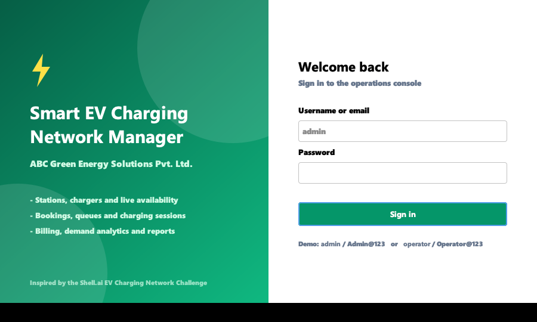

Enter your username (or email) and password. After 5 wrong attempts the account is locked, and an administrator must re-activate it in **User Management**. Customers cannot log in to the desktop app; they use the web portal.

### B.2 Dashboard
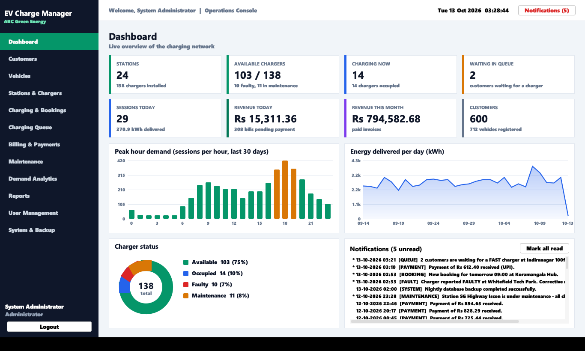

- **KPI cards:** stations, available chargers, sessions charging now, waiting queue, sessions and revenue today, monthly revenue, customers.
- **Peak hour demand:** sessions per hour over the last 30 days. Orange bars are peak hours.
- **Energy per day:** kWh delivered over the last 30 days.
- **Charger status:** available / occupied / faulty / maintenance.
- **Notifications:** queue joins, automatic allocations, faults, bookings, payments, maintenance. Unread ones are marked with `*`. Use **Mark all read** to clear them. The **Notifications (n)** button in the top bar shows the unread count from any screen.
- The page refreshes itself every 20 seconds.

### B.3 Customers and Vehicles
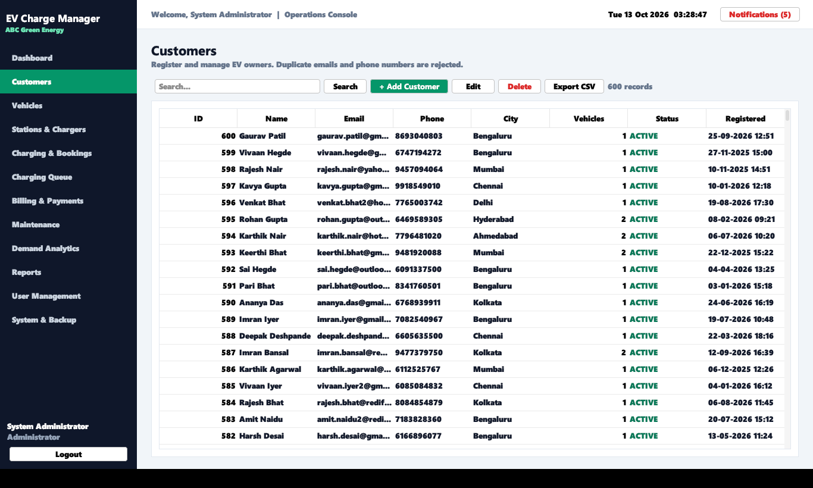

- **Search** by name, email, phone or city. Use **+ Add**, **Edit** (or double-click a row), **Delete** and **Export CSV**.
- Email and mobile must be unique and valid (10 digits starting with 6–9).
- **Vehicles:** choose the owner, then enter the registration number (e.g. `KA01AB1234`), make, model, type, battery kWh and connector.

### B.4 Stations and Chargers
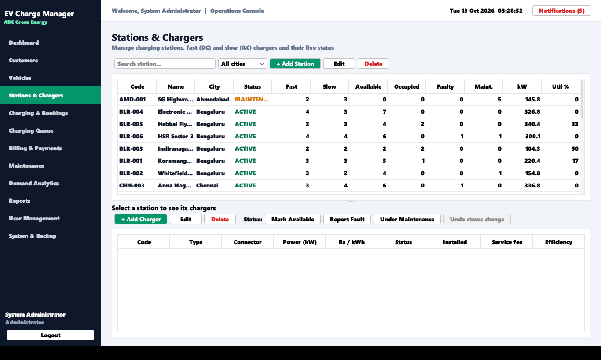

- The upper table lists stations with live counts and utilisation %. Filter by city or search.
- Select a station to see its chargers in the lower table.
- **+ Add Charger:** FAST (DC) or SLOW (AC), power, tariff and connector.
- **Mark Available / Report Fault / Under Maintenance** changes a charger's status. Reporting a fault notifies operators.
- **Undo** reverses the last status changes, one by one.

### B.5 Charging and Bookings
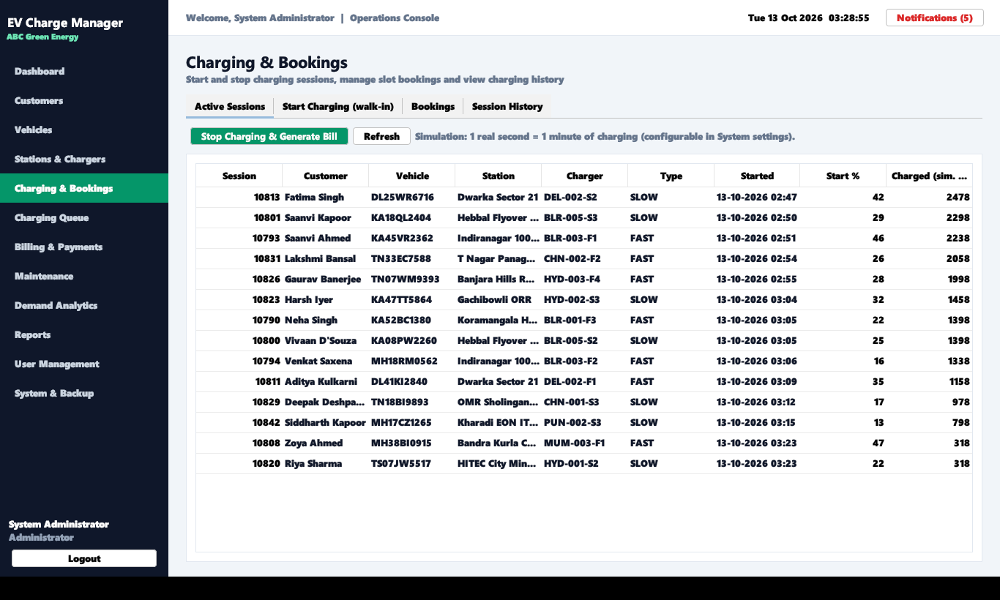

| Tab | Use |
|---|---|
| Active Sessions | All vehicles charging now. Select one and click **Stop Charging & Generate Bill** to see the receipt, which you can save as .txt or .html. |
| Start Charging (walk-in) | Choose customer, vehicle, station, charger type and battery %, then click **Charge Now**. If no charger is free, the customer joins the queue and the estimated wait is shown. |
| Bookings | Upcoming reservations. **+ New Booking**, **Start Session** (asks for battery %), **Cancel Booking**, **Mark No-show**. |
| Session History | Search all sessions, with energy, duration, cost and payment status. |

*Simulation:* 1 real second equals 1 minute of charging (setting `simulation_speed_factor`). A session stopped after 30 seconds is billed for 30 minutes.

### B.6 Charging Queue
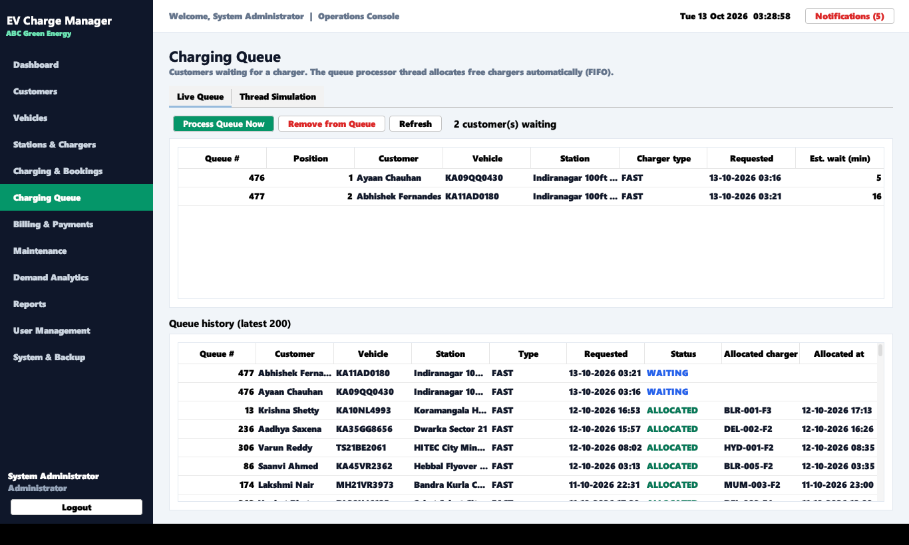

- **Live Queue:** waiting customers with their position and estimated wait. **Process Queue Now** triggers allocation immediately (it also happens automatically every 10 seconds and whenever a charger becomes free). **Remove from Queue** cancels an entry.
- **Thread Simulation:** set the number of chargers and vehicles and click **Run Simulation** to watch the producer/consumer threads in the log.

### B.7 Billing and Payments
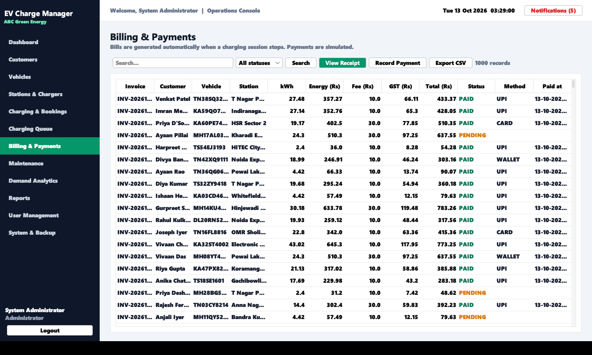

Filter by status (PENDING / PAID / FAILED).
- **View Receipt:** shows the invoice.
- **Record Payment:** records a payment at the counter (cash, UPI, card...). Test failures: `fail@upi`, or a card ending in `0000`.

### B.8 Maintenance
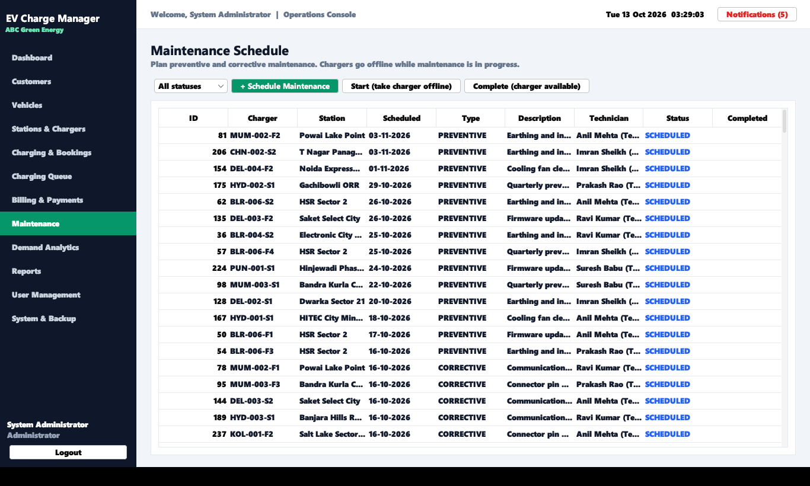

**+ Schedule Maintenance** takes a charger, date, type, description and technician.
- **Start** takes the charger offline (MAINTENANCE).
- **Complete** makes it AVAILABLE again and serves the queue.

### B.9 Demand Analytics
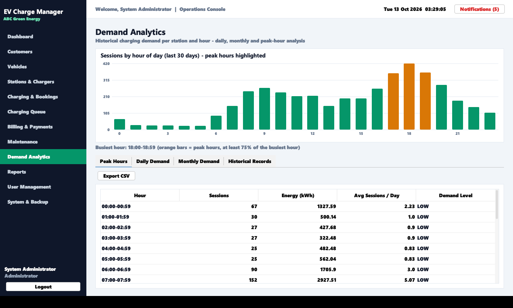

- The peak-hour chart shows sessions per hour over the last 30 days. Orange bars are peak hours, and the busiest hour is named below the chart.
- Tabs show peak hours, daily demand, monthly demand and **Historical Records** (filter by station and date).
- **Import CSV** expects the columns `station_code,date,hour,sessions,energy_kwh`. **Export CSV** saves the current table.

### B.10 Reports
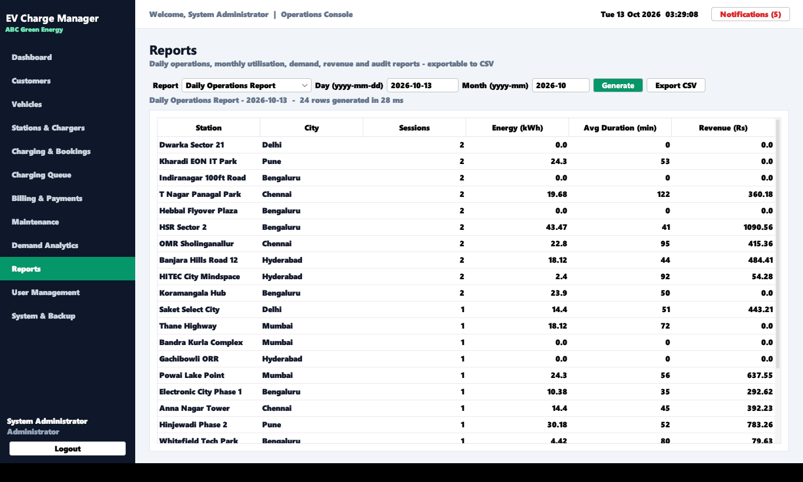

Choose a report and set the day or month as needed, then click **Generate** and **Export CSV** (saved in `reports/`). The generation time is shown.

The reports are: Daily Operations, Monthly Utilisation, Peak Hour Demand, Daily Demand, Monthly Demand, Station Utilisation, Revenue, Top Customers and Audit Log.

### B.11 User Management (administrator only)
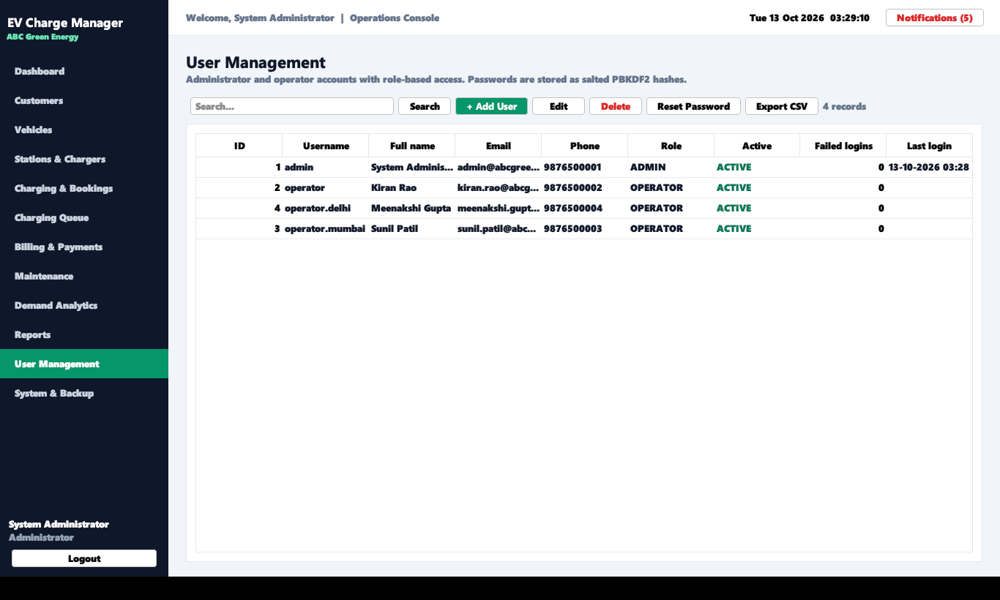

Create operator or admin accounts (strong password required), edit details, enable or disable accounts (this unlocks locked ones), reset passwords and delete accounts.

### B.12 System and Backup (administrator only)
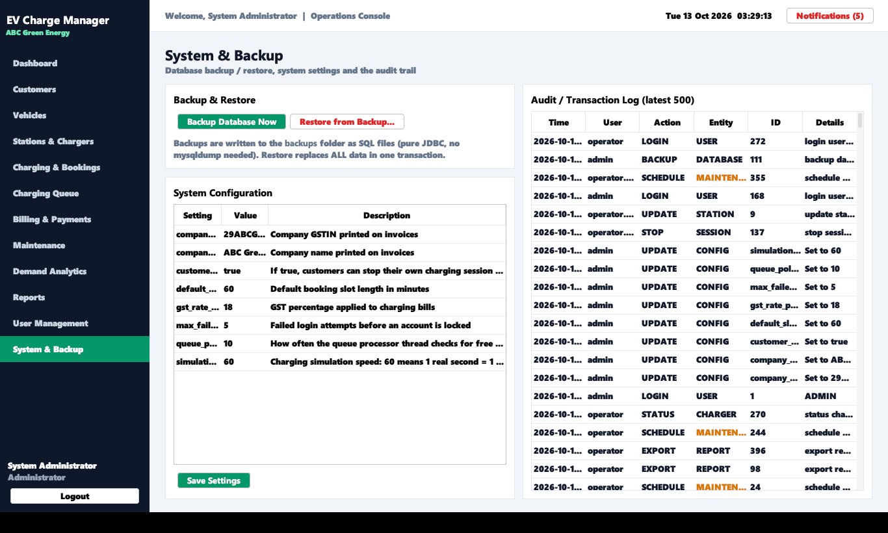

- **Backup Database Now** writes `backups/ev_backup_<date>_<time>.sql`.
- **Restore from Backup** replaces all data in one transaction. If anything fails, nothing changes.
- **System Configuration:** GST %, simulation speed, failed-login limit, queue polling seconds, default slot length, the company name and GSTIN on invoices, and `customer_stop_charging_enabled` (`true` = customers can stop their own charging from the web portal; `false` = only operators stop sessions). Edit the values, then click **Save Settings**.
- **Audit log:** the latest 500 actions, showing who did what and when.

---

## Part C: Web portal (Customers)

| Page | How to use |
|---|---|
| **Home / Find Stations** 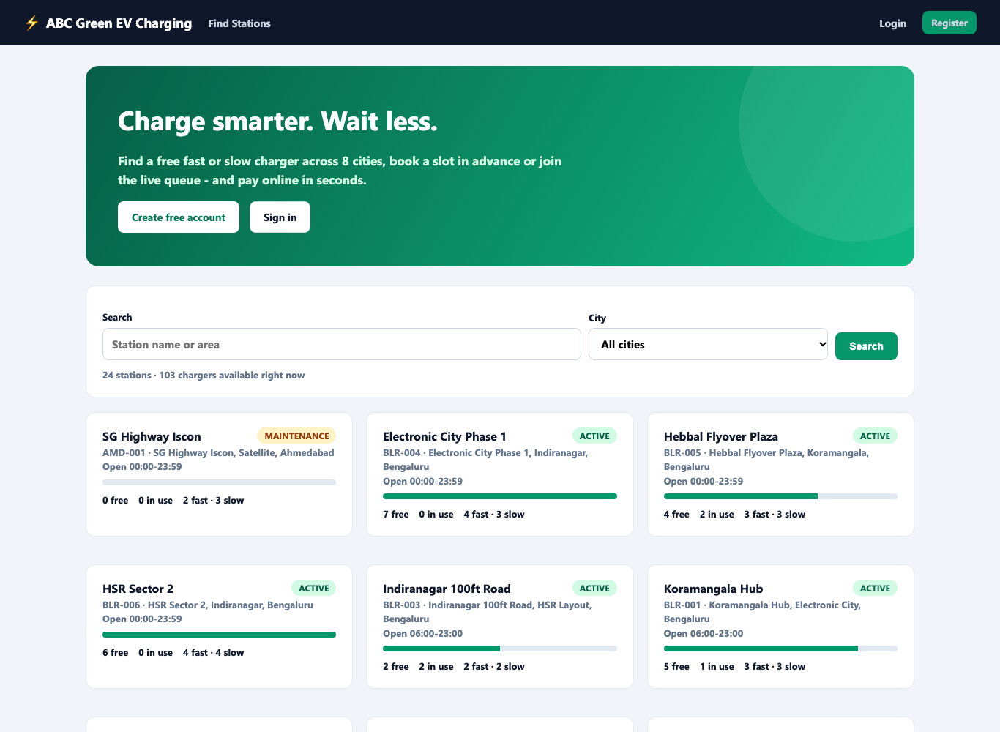 | Search by name or city. Each card shows free and in-use chargers. |
| **Register** | Fill in your name, username, email, mobile, city and a strong password. You are logged in automatically. |
| **My Dashboard** 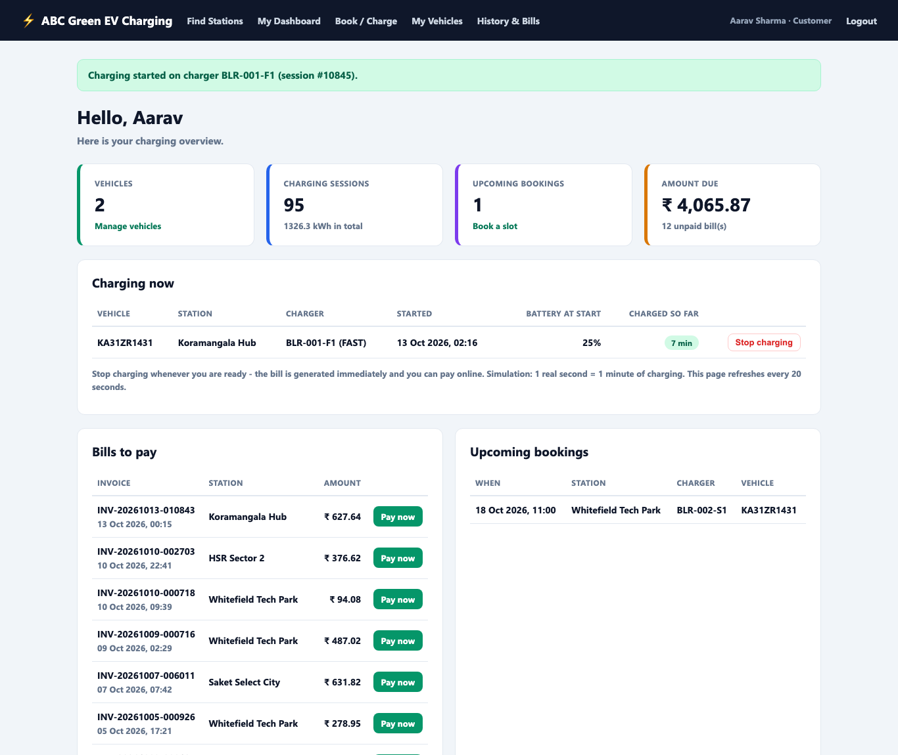 | Vehicles, sessions, upcoming bookings and amount due. If you are in a queue, it shows your estimated wait (the page auto-refreshes); you can also **Leave queue**. While charging, **Charging now** shows the minutes charged so far and, if the administrator has enabled it, a **Stop charging** button: the bill is created immediately and you go straight to the payment page. |
| **My Vehicles** | Add or remove vehicles. |
| **Book / Charge** 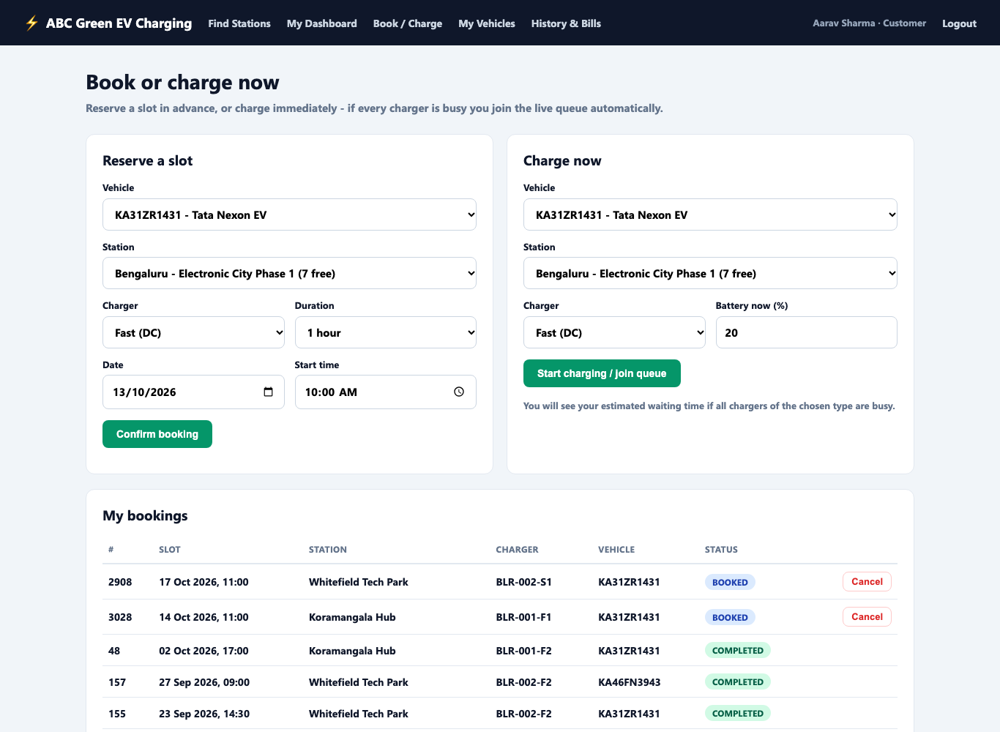 | **Reserve a slot:** choose vehicle, station, charger type, date, time and duration. **Charge now:** starts immediately, or adds you to the queue. Cancel bookings in "My bookings". |
| **History & Bills** 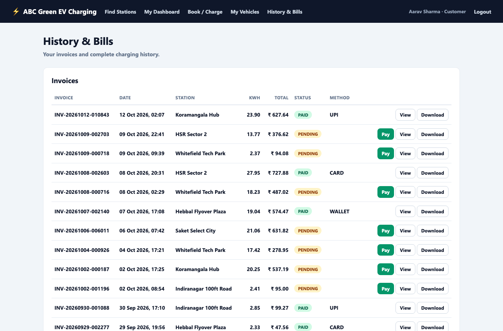 | All invoices: **Pay**, **View**, **Download**. Full session history. |
| **Pay** 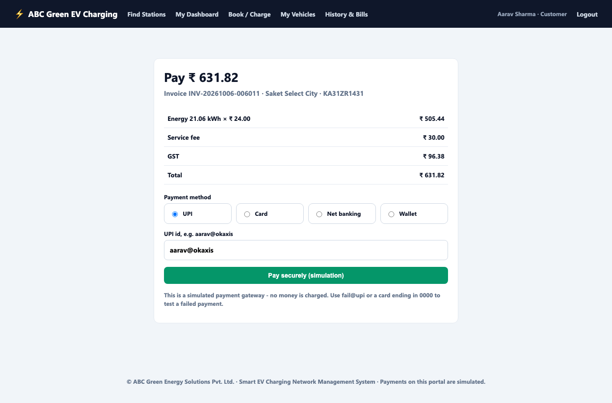 | Choose UPI, card, net banking or wallet. The payment is simulated. |
| **Invoice** 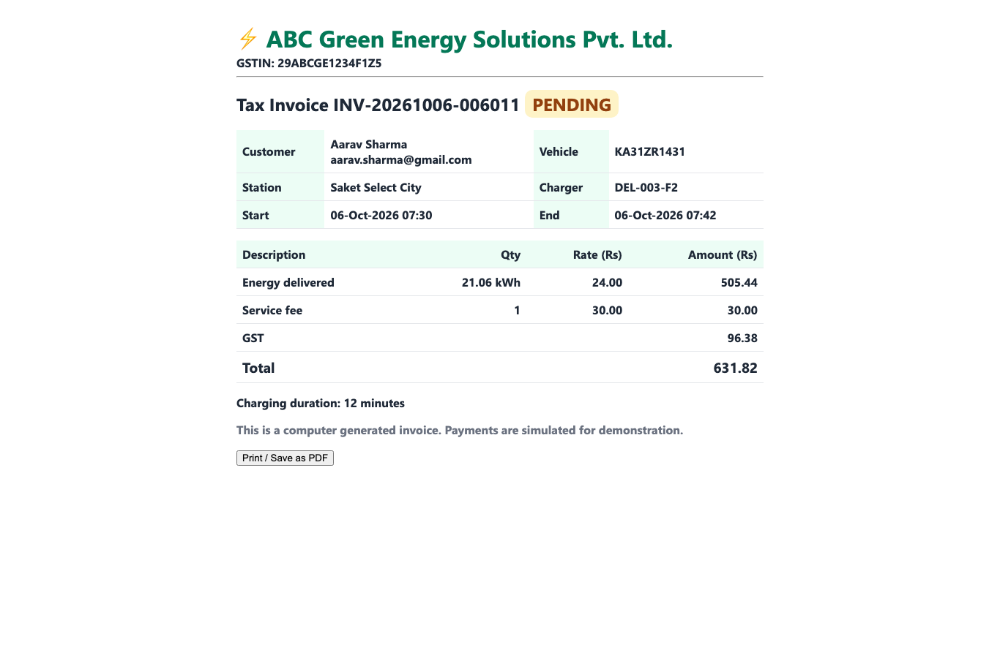 | Printable tax invoice. Use the browser's "Save as PDF" option. |

### Admin web pages
Log in as `admin` to see:
- **Admin Dashboard:** KPIs, Chart.js peak-hour, energy and revenue-by-city charts, notifications, waiting queue and station utilisation.
- **Reports:** any report in the browser, with **Download CSV**.

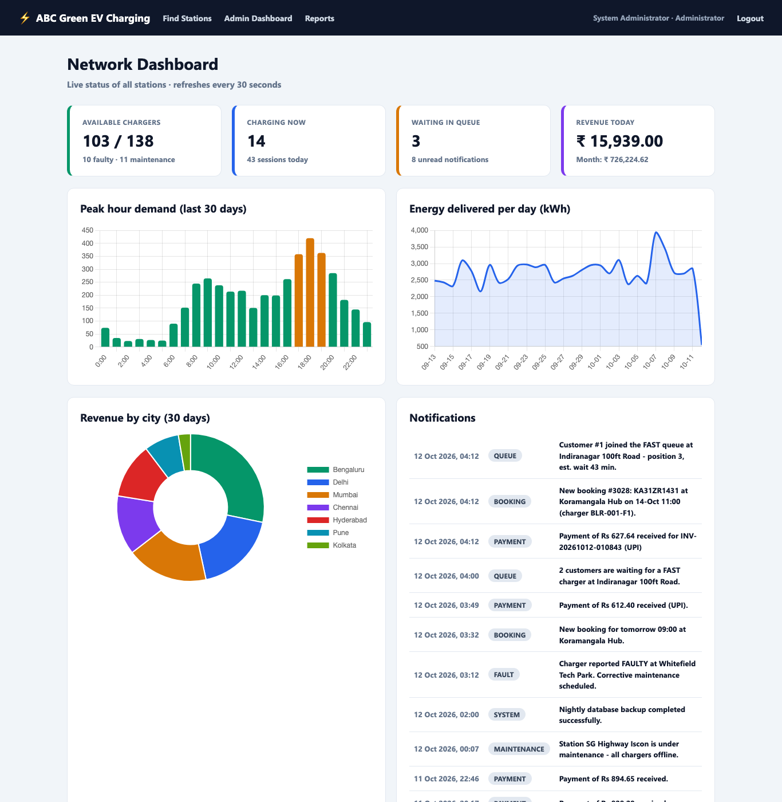

There is also a JSON API for future mobile or map apps: `GET /api/stations?city=Pune`

---

## Part D: FAQ
- **I forgot the admin password.** Rerun `DatabaseSetup` (this resets all demo data), or update the `users` table from a fresh hash.
- **Where are files saved?** In the `reports/`, `backups/` and `logs/` folders inside the project folder. In Eclipse, press F5 on the project to refresh and see them.
- **Can the desktop and web apps run together?** Yes. They share the database. The queue thread runs in both, and allocation is protected by database transactions.
